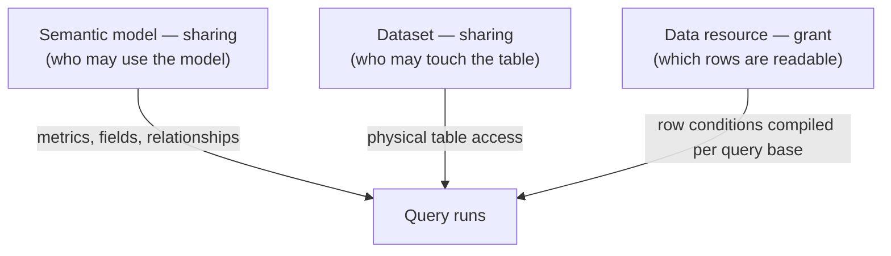
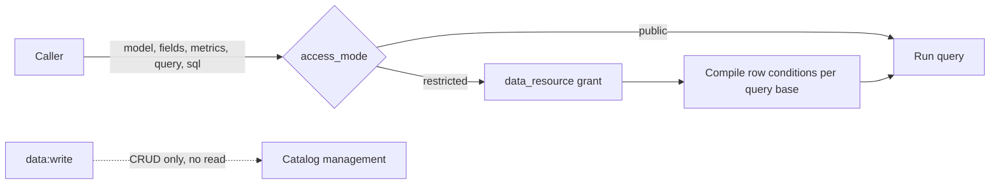

# Catalog data access (models · resources · rows)

How openKMS decides **who may read which rows of which tables** through the Catalog — including
intranet services that are not openKMS users.

**Related:** [Data security](data-security.md) (resource ACL mechanics), [Security design](../security.md)
(principles), [Data layer](data-layer.md) (semantic models, Playground, SQL Lab), [API reference](api-reference.md).

---

## For AI agents — quick facts

| Question | Answer |
|---|---|
| What is a data resource? | A named slice of **one** semantic model, defined by **row conditions on entities** |
| Who decides access? | `resource_acl_entries` with `resource_type = 'data_resource'` — **not** an operation key |
| Public vs restricted | `semantic_models.access_mode`; `public` answers **any authenticated caller**, `restricted` needs a grant |
| Row enforcement | `row_policy` injected at query compile / SQL rewrite — never sent by the caller |
| Admin escape hatch | **None** for reading restricted data; `admin` / `all` configure grants, they do not bypass them |
| Missing claim | Denies the query; a predicate is never silently dropped |
| Tables | `data_resources`, `semantic_models.access_mode`, `semantic_model_query_runs.data_resource_id` |

---

## Three grants, three different questions

A Catalog answer passes **three independent gates**, and they are not interchangeable. Treating
them as one is what produced the current confusion: a "sharing panel" that offered a *write*
checkbox on data that is read-only, and a semantic model with no sharing at all.

| Layer | Object | Question it answers | Granted through |
|---|---|---|---|
| **Model** | Semantic model | May this caller **see and use** this model — its metrics, fields, relationships? | resource ACL, `resource_type = 'semantic_model'` (model **Settings → Sharing**) |
| **Dataset** | Physical table | May this caller **touch this table**? | resource ACL, `resource_type = 'dataset'` (already exists) |
| **Rows** | Data resource | Within the model, **which entities** may this caller read? | resource ACL, `resource_type = 'data_resource'` |



**Why they are separate objects, not one setting.** A model is a *definition* (curated metrics
and joins over several tables). A dataset is a *physical table* shared with the same mechanics as
a document or a knowledge base. A data resource is neither: it is a **row-scoped capability over
one model**, and its only meaningful verb is *read*. Collapsing the third into the first would
mean a "write" permission on something that cannot be written, and no way to express "read only
semiconductors" separately from "may use the Stock model".

### How the three combine on a query

`POST /semantic-models/{id}/query` must satisfy, in order:

1. **Model access** — the caller holds a read grant on the model (`Settings → Sharing`).
2. **Row scope** — when the model is `restricted`, a granted `resource_id` is required, and its
   row conditions are compiled against whichever dataset the query reads.
3. **Table access** — the datasets the query touches are the model's own; the row condition is
   what narrows them, not the dataset ACL. (Dataset ACL governs *direct* table access such as
   `GET /api/datasets/{id}` and the rows browser.)

> **Order matters.** Model sharing is checked first: a model with an ACL row is closed to
> callers outside its grants, whether or not it is `public`. `access_mode` then decides the
> **row scope within** a model the caller may already open. A new model bootstraps an owner-only
> grant, so it starts closed to everyone but its creator — the same rule every securable type
> follows.

## Operation permissions vs data permissions

`data:read` answers "may this caller use the Data Model feature". It does **not** answer
"may this caller read these rows". Conflating them gave two wrong answers at once: a granted
external service could not query without also being made a Catalog user, and a Catalog user
could read restricted rows.

| Plane | Question | Gate |
|---|---|---|
| **Data plane** | May this caller read this model / these rows? | data resource grant; public models are open |
| **Management plane** | May this caller edit the Catalog? | `data:read` / `data:write` |



| Surface | Gate |
|---|---|
| `GET /api/semantic-models`, `GET /api/metrics` (lists) | `data:read` — a browse of names/descriptions, filtered to readable models |
| `GET /api/semantic-models/{id}`, `/fields`, `/export` | **data plane** |
| `GET /api/metrics/{id}`, `/{id}/compute`, `/{id}/runs` | **data plane**, via the metric's model |
| `POST /api/semantic-models/{id}/query`, `…/sql` | **data plane** (`resource_id` required when restricted) |
| `GET /api/data-resources[/{id}]` | **data plane** — filtered to resources you may read |
| Model / dataset / metric / resource CRUD, import | `data:write` |

A public model is readable by **any authenticated principal**, including one that only uses
documents. That is what "public dataset" means here, and it is deliberate.

**A grant is never a substitute for `data:write`, and an operation key is never a substitute
for a grant.**

---

## How to use it

### 1. Choose public or restricted

**Data Model** → model → **Settings** → **Access mode**.

| `access_mode` | Who can query | Row policy |
|---|---|---|
| `public` (default) | Any authenticated caller | none |
| `restricted` | Only holders of a read grant on one of the model's resources | that resource's `row_policy` |

A restricted model **requires `resource_id`** on every query/SQL call; omitting it is `400`
`RESOURCE_REQUIRED`. Several grants do not auto-pick — the caller chooses.

### 2. Create a data resource

**Data Model** → model → **Data resources** lists what exists. **New resource** opens a dialog
for the name and row conditions; creating one goes straight to the resource's own page, because
granting access is the next thing an author does there.

```text
DataResource {
  name, description
  semantic_model_id      # the model this slice belongs to
  row_policy[]           # entity-level conditions, ANDed into every query
}
```

- A capability, not a table copy and not a user.
- Several resources can share one model (华东 / 华北) — different policy, same tables.
- Creating needs `data:write`; the creator gets owner `rwm`.

### 3. Grant it

**A data resource's access list answers one question: who may read these rows.**

It is not a sharing panel. Three things are deliberately absent:

- **No write.** There is no content to edit; a `w` bit would authorize nothing. The ACL API
  strips it for this type rather than storing a permission no check reads.
- **No manage.** "May administer this resource" is *ownership*, not data access — it belongs in
  **Sharing** with every other resource, not in the list of people allowed to query rows.
  Letting the reader list also grant `m` meant saving a read list could hand out administrative
  rights as a side effect.
- **No channel wording.** "Channel creator / New channels" describes documents, not data grants.

| Object | Panel | Bits that mean something |
|---|---|---|
| Semantic model | **Settings → Sharing** | `r` / `w` / `m` |
| Dataset | **Sharing** in dataset detail | `r` / `w` / `m` |
| Data resource | **Grantees** tab on the resource's page | **`r` only** — who may administer the resource is set in its **Sharing** |

When granting a data resource, the panel should also show **the row conditions being granted** —
granting `industry = 半导体` is a different act from granting the whole model, and the reviewer
needs to see which one they are approving.

API: `PUT /api/resource-acl/data_resource/{id}`. Console → **Data Security** manages access groups
and flags sharing problems across every securable type.

**Page layout.** The resources list answers "what slices exist" — name and the condition in one
line, plus delete. The resource page (`/data-model/{id}/resources/{resourceId}`) splits its two
concerns into tabs: **Definition** (name, row conditions) and **Grantees** (who may read). They
are edited at different times for different reasons, and the condition itself is already in the
page header — repeating it above the grantee table was noise. The tab strip is the shared
settings-page one, so this page reads like the rest of the app.

On **Grantees**, the toolbar filters the people who already have access, and **Add** opens a
dialog to pick someone new. Filtering a table and choosing an identity are different tasks; the
earlier inline "search then select" did both in the table footer and read like neither.

On **Grantees**, the toolbar filters the people who already have access, and **Add** opens a
dialog to pick someone new. Filtering a table and choosing an identity are different tasks; the
earlier inline "search then select" did both in the table footer and read like neither.

### 4. Call it

```http
GET  /api/data-resources?semantic_model_id={model_id}   → resources you may use

POST /api/semantic-models/{model_id}/query
{ "metric": "gmv", "group_by": [{"field": "region"}], "resource_id": "<id>" }

POST /api/semantic-models/{model_id}/sql
{ "sql": "SELECT region, sum(amount) FROM orders GROUP BY region", "resource_id": "<id>" }
```

**qa-agent** needs no configuration: it reads the model's access mode and passes a granted
resource, reporting "no grant" clearly instead of surfacing a bare 400.

**Playground** (Data Model → model → Playground) asks for the resource up front. The page
itself still sits under `data:read`; a caller with only a grant uses the API.

---

## Row policy semantics

A policy is a **structured list**, never SQL text:

```json
[
  { "column": "industry", "op": "=", "value": "半导体" },
  { "column": "org_id", "op": "=", "claim": "ext.org_id" }
]
```

### Conditions describe entities, not tables

A model is a set of datasets joined on shared keys, and a metric's `FROM` is only one of them.
Writing `industry = 半导体` must therefore constrain a query whose base is `daily_basic` just as
much as one whose base is `stock_basic` — otherwise the restriction is configured but enforces
nothing, because the query never reads the table the condition was written against.

The compiler walks the model's **relationships** (the Ossie `from` → `to` foreign keys) and
emits, for a base that does not own the column:

```sql
EXISTS (
  SELECT 1 FROM "tushare"."stock_basic" rpo0
  WHERE base."ts_code" = rpo0."ts_code"
    AND rpo0."industry" = :param
)
```

When the base *does* own the column it becomes a plain predicate on the base alias.

**Conditions on the same owner share one subquery** when that is provably equivalent. Two
separate `EXISTS` let *different* owner rows satisfy different conditions; one
`EXISTS … AND …` demands a single row satisfy all of them. So they merge only when a base row
can match at most one owner row — the path walks `from` → `to` throughout, and the final hop
lands on the owner's declared primary key or unique key. Otherwise they stay separate.
Merging three conditions on one dimension measured **72 ms → 31 ms** on 1M fact rows, same rows.

PostgreSQL rewrites a correlated `EXISTS` into a semi-join, so this costs the same as a
`JOIN` — **and it does not multiply rows** the way a `JOIN` does when a dimension has
duplicate keys. That is the correctness reason, not a performance one.

**Every ambiguous case refuses the query** instead of guessing — two paths can produce
different row sets, so "pick one" would silently change who sees what:

| Situation | Code |
|---|---|
| Column exists on several datasets and was not qualified | `ROW_POLICY_AMBIGUOUS_COLUMN` |
| Column names no dataset of the model | `ROW_POLICY_UNKNOWN_COLUMN` |
| Owner unreachable, or reachable by more than one equally short path | `ROW_POLICY_NO_PATH` |

A column may be qualified as `table.column` (table name, id, or display label) to resolve an
otherwise ambiguous name.

| Rule | Why |
|---|---|
| Operators are the grid's vocabulary (`=`, `!=`, `>`, `>=`, `<`, `<=`, `like`, `in`, `between`, `is_null`, `is_not_null`) | One validated operator set |
| `not_in` is rejected | A deny-list silently includes NULLs and future values |
| Values are parameterized | A policy cannot smuggle SQL |
| `claim` binds a token path (`ext.org.id` resolves nested) | Row scope can follow the caller's organisation |
| A missing claim **denies** the query (`ROW_POLICY_CLAIM_MISSING`) | Dropping a predicate widens the result set — that is escalation |
| Each condition needs `value` or `claim` | `col = NULL` never matches; `is_null` says it explicitly |
| Equality excludes NULL | Plain SQL semantics; opt in with `is_null` |

### Where it is enforced

| Path | Mechanism |
|---|---|
| Builder / metric query | Conditions AND-ed onto the base alias **after** definition and request filters |
| SQL Lab | The base relation is aliased `rpbase`; the policy compiled against that alias is applied, and a statement that already aliases the base is refused with instructions |
| Dataset rows API | Unchanged — dataset ACL; resource grants are the Catalog gate |

Request filters narrow the result and can never widen it: the policy is appended last and the
caller cannot reach the clause list.

SQL Lab cannot be rewritten generically, so it **fails closed**:

| Statement | Result |
|---|---|
| Only public dimension tables | Allowed — no base rows involved |
| Base table of a restricted model | Resource required; policy compiled against it |
| `"schema"."table"."column"` three-part reference | Refused — the substitution cannot preserve it |
| Dimension table that is itself restricted | Its own resource rules apply |

---

## Errors

| Status / code | Meaning | Fix |
|---|---|---|
| `400 RESOURCE_REQUIRED` | Restricted model, no `resource_id` | Pass a granted resource |
| `403 MODEL_FORBIDDEN` | Restricted model, no grant at all | Ask the owner for access |
| `403 RESOURCE_FORBIDDEN` | Resource id passed, no read grant | Same |
| `403 ROW_POLICY_CLAIM_MISSING` | Policy binds a claim the token lacks | Supply the claim, or use a policy without it |
| SQL Lab "schema.table.column" | Statement cannot be constrained | Reference columns via an alias or unqualified |

---

## Audit

`semantic_model_query_runs` records every SQL Lab run and every Builder run that used an
ad-hoc expression / `where` / `having`, including `data_resource_id`, the SQL, row count and
who ran it — enough to answer "why did this query see these rows".
`policy_fingerprint(row_policy)` gives a stable short id for the applied constraint.

## Non-goals (v1)

- Column masking / projection policy
- Warehouse-native RLS (PostgreSQL policies) — enforced in Catalog instead
- Public-internet callers, or mapping arbitrary external end-users into openKMS `users`
- Service-principal wire format for sibling apps — an intranet service presents a grantable
  principal; the transport carrying it is a separate decision
