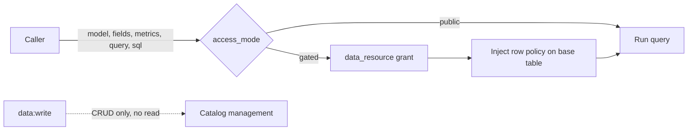

# Catalog data access (resources · grants · rows)

How openKMS decides **which rows of which tables** a Catalog caller may read — including
intranet services that are not openKMS users.

**Related:** [Data security](data-security.md) (resource ACL mechanics), [Security design](../security.md)
(principles), [Data layer](data-layer.md) (semantic models, Playground, SQL Lab), [API reference](api-reference.md).

---

## For AI agents — quick facts

| Question | Answer |
|---|---|
| What is a data resource? | A named slice of **one** semantic model: optional base table + row policy |
| Who decides access? | `resource_acl_entries` with `resource_type = 'data_resource'` — **not** an operation key |
| Public vs gated | `semantic_models.access_mode`; `public` answers **any authenticated caller**, `gated` needs a grant |
| Row enforcement | `row_policy` injected at query compile / SQL rewrite — never sent by the caller |
| Admin escape hatch | **None** for reading gated data; `admin` / `all` configure grants, they do not bypass them |
| Missing claim | Denies the query; a predicate is never silently dropped |
| Tables | `data_resources`, `semantic_models.access_mode`, `semantic_model_query_runs.data_resource_id` |

---

## Two planes — only one of them is an operation permission

`data:read` answers "may this caller use the Data Model feature". It does **not** answer
"may this caller read these rows". Conflating them gave two wrong answers at once: a granted
external service could not query without also being made a Catalog user, and a Catalog user
could read gated rows.

| Plane | Question | Gate |
|---|---|---|
| **Data plane** | May this caller read this model / these rows? | data resource grant; public models are open |
| **Management plane** | May this caller edit the Catalog? | `data:read` / `data:write` |



| Surface | Gate |
|---|---|
| `GET /api/semantic-models`, `GET /api/metrics` (lists) | `data:read` — a browse of names/descriptions, filtered to readable models |
| `GET /api/semantic-models/{id}`, `/fields`, `/export` | **data plane** |
| `GET /api/metrics/{id}`, `/{id}/compute`, `/{id}/runs` | **data plane**, via the metric's model |
| `POST /api/semantic-models/{id}/query`, `…/sql` | **data plane** (`resource_id` required when gated) |
| `GET /api/data-resources[/{id}]` | **data plane** — filtered to resources you may read |
| Model / dataset / metric / resource CRUD, import | `data:write` |

A public model is readable by **any authenticated principal**, including one that only uses
documents. That is what "public dataset" means here, and it is deliberate.

**A grant is never a substitute for `data:write`, and an operation key is never a substitute
for a grant.**

---

## How to use it

### 1. Choose public or gated

**Data Model** → model → **Settings** → Access.

| `access_mode` | Who can query | Row policy |
|---|---|---|
| `public` (default) | Any authenticated caller | none |
| `gated` | Only holders of a read grant on one of the model's resources | that resource's `row_policy` |

A gated model **requires `resource_id`** on every query/SQL call; omitting it is `400`
`RESOURCE_REQUIRED`. Several grants do not auto-pick — the caller chooses.

### 2. Create a data resource

**Data Model** → model → **Data resources** → New.

```text
DataResource {
  name, description
  semantic_model_id      # the model this slice belongs to
  base_dataset_id        # table the row policy applies to (null = whole model)
  row_policy[]           # ANDed into every query; [] = whole base table
}
```

- A capability, not a table copy and not a user.
- Several resources can share one model (华东 / 华北) — different policy, same tables.
- Creating needs `data:write`; the creator gets owner `rwm`.

### 3. Grant it

Same page, the sharing panel under each resource: add a **user** or **access group** with `r`.
Console → **Data Security** manages groups and flags sharing problems.
API equivalent: `PUT /api/resource-acl/data_resource/{id}`.

### 4. Call it

```http
GET  /api/data-resources?semantic_model_id={model_id}   → resources you may use

POST /api/semantic-models/{model_id}/query
{ "metric": "gmv", "group_by": [{"field": "region"}], "resource_id": "<id>" }

POST /api/semantic-models/{model_id}/sql
{ "sql": "SELECT region, sum(amount) FROM orders GROUP BY region", "resource_id": "<id>" }
```

**qa-agent** needs no configuration: it reads the model's access mode and passes a granted
resource, reporting "no grant" clearly instead of surfacing a bare 400.

**Playground** (Data Model → model → Playground) asks for the resource up front. The page
itself still sits under `data:read`; a caller with only a grant uses the API.

---

## Row policy semantics

A policy is a **structured list**, never SQL text:

```json
[
  { "column": "region", "op": "=", "value": "east" },
  { "column": "org_id", "op": "=", "claim": "ext.org_id" }
]
```

| Rule | Why |
|---|---|
| Operators are the grid's vocabulary (`=`, `!=`, `>`, `>=`, `<`, `<=`, `like`, `in`, `between`, `is_null`, `is_not_null`) | One validated operator set |
| `not_in` is rejected | A deny-list silently includes NULLs and future values |
| Values are parameterized | A policy cannot smuggle SQL |
| `claim` binds a token path (`ext.org.id` resolves nested) | Row scope can follow the caller's organisation |
| A missing claim **denies** the query (`ROW_POLICY_CLAIM_MISSING`) | Dropping a predicate widens the result set — that is escalation |
| Each condition needs `value` or `claim` | `col = NULL` never matches; `is_null` says it explicitly |
| Equality excludes NULL | Plain SQL semantics; opt in with `is_null` |

### Where it is enforced

| Path | Mechanism |
|---|---|
| Builder / metric query | Conditions AND-ed onto the base alias **after** definition and request filters |
| SQL Lab | Every reference to the base table becomes `(SELECT * FROM base WHERE <policy>)`, keeping the caller's alias |
| Dataset rows API | Unchanged — dataset ACL; resource grants are the Catalog gate |

Request filters narrow the result and can never widen it: the policy is appended last and the
caller cannot reach the clause list.

SQL Lab cannot be rewritten generically, so it **fails closed**:

| Statement | Result |
|---|---|
| Only public dimension tables | Allowed — no base rows involved |
| Base table of a gated model | Resource required; policy injected |
| `"schema"."table"."column"` three-part reference | Refused — the substitution cannot preserve it |
| Dimension table that is itself gated | Its own resource rules apply |

---

## Errors

| Status / code | Meaning | Fix |
|---|---|---|
| `400 RESOURCE_REQUIRED` | Gated model, no `resource_id` | Pass a granted resource |
| `403 MODEL_FORBIDDEN` | Gated model, no grant at all | Ask the owner for access |
| `403 RESOURCE_FORBIDDEN` | Resource id passed, no read grant | Same |
| `403 ROW_POLICY_CLAIM_MISSING` | Policy binds a claim the token lacks | Supply the claim, or use a policy without it |
| SQL Lab "schema.table.column" | Statement cannot be constrained | Reference columns via an alias or unqualified |

---

## Audit

`semantic_model_query_runs` records every SQL Lab run and every Builder run that used an
ad-hoc expression / `where` / `having`, including `data_resource_id`, the SQL, row count and
who ran it — enough to answer "why did this query see these rows".
`policy_fingerprint(row_policy)` gives a stable short id for the applied constraint.

## Non-goals (v1)

- Column masking / projection policy
- Warehouse-native RLS (PostgreSQL policies) — enforced in Catalog instead
- Public-internet callers, or mapping arbitrary external end-users into openKMS `users`
- Service-principal wire format for sibling apps — an intranet service presents a grantable
  principal; the transport carrying it is a separate decision
