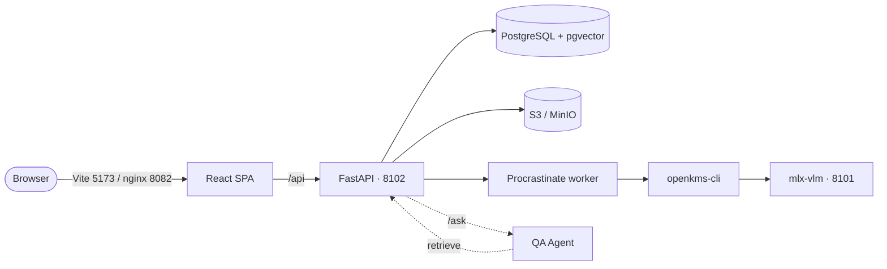

# openKMS

**Open Knowledge Management System** — openKMS helps enterprises build intelligent decision systems that are dependable and adaptable.

A decision system takes a case in, applies rules and evidence, and returns a conclusion. The hard part is making the conclusion dependable: it has a basis, can be recomputed, and states its boundary.

[Repository on GitHub :material-github:](https://github.com/yingrui/openKMS){ .md-button .md-button--primary }
[Quickstart](quickstart.md){ .md-button }

---

## What you build

A decision system: case in → conclusion out, with its basis, computation, and boundary attached.

Typical domains: customs classification, insurance underwriting, quality release, compliance review.

It is not an app generator, a document store, a chat window, or a BI tool. The longer argument is in [Goals](goals.md).

## How it works

- Knowledge, data, and ontology come first; AI builds the system on top.
- Rules are explicit; conclusions are computed from sourced data, not guessed.
- Business experts change the rules; IT handles data access, permissions, security, and delivery.

## What's inside

| Surface | Role |
|---------|------|
| **[Documents](features/documents.md)** | Upload PDFs and office files; parse to editable Markdown (PaddleOCR-VL via a separate VLM server); versions and policy **lifecycle**. |
| **[Articles](features/articles.md)** | Markdown CMS with channels, attachments, and relationships (`supersedes`, `amends`, `see_also`, …). |
| **[Wiki spaces](features/wiki-spaces.md)** | Path-based notes, vault import, page graph, semantic page search. |
| **[Knowledge bases](features/knowledge-bases.md)** | Hybrid search and **Q&A with provenance** (chunks, sources, optional QA Agent service). |
| **[Ontology](features/ontology.md) & [data layer](features/data-layer.md)** | Object/link types, instances, datasets, and semantic models; graph and relational queries. |
| **[Functions & actions](features/ontology-functions.md)** | Published functions and typed actions on objects; execution and audit. |
| **[Agents](features/openkms-agents.md) & [skill](features/openkms-skill.md)** | Deep Agents workspaces, and the openkms skill/CLI for agents calling the public API. |
| **[Chamber](features/app-builder.md)** | Register and run decision-system UIs against a Kubernetes Service; identity headers and proxy. |

**Foundations:** [operation permissions + resource ACL](features/data-security.md) (admin does not imply read-all data), and [evaluations](features/evaluation.md) for retrieval and wiki coverage.

## Where to start

| If you want to… | Read |
|---|---|
| Understand **why** openKMS exists (vision & business problems) | [Goals & vision](goals.md) |
| Try it locally with Docker or on the host | [Quickstart](quickstart.md) |
| Learn ontology by building a mini Kanban | [Tutorial: Understanding the ontology (Kanban lab)](tutorials/understanding-ontology.md) |
| DIY a Tushare → Stock → Function case study | [Tutorial: Tushare market ontology](tutorials/tushare-market-ontology.md) |
| Understand the system | [Architecture](architecture.md) · [Functionalities](functionalities.md) |
| Find a specific feature or API | [Functionalities](functionalities.md) → `features/*.md` |
| HTTP or schema reference | [API reference](features/api-reference.md) · Data models |
| Knowledge artifact types | [Knowledge types](features/knowledge-types.md) |
| Sharing and resource ACL | [Data security](features/data-security.md) |
| Use openKMS from an agent (skill + CLI) | [openkms-skill](features/openkms-skill.md) |
| Set up a dev environment | [Developer setup](developer/setup.md) |
| Deploy with Docker | [Operations · Docker](operations/docker.md) |
| Review security design (principles) | [Security](security.md) · [Data security](features/data-security.md) · [Console & auth](features/console-and-auth.md) |
| See what's planned next | [Roadmap · Development plan](development_plan.md) |
| Compare openKMS to other stacks or read KM frameworks | [Research](#research) (below) |
| Edit the docs (human or AI agent) | [Doc conventions for AI agents](agents.md) |

## Research {#research}

Notes for architecture and product decisions (not shipped feature specs):

| Topic | Document |
|--------|----------|
| RAG engine vs openKMS | [RAGFlow vs openKMS](research/ragflow_vs_openkms.md) |
| Confluence AI (Rovo) vs openKMS | [Confluence AI vs openKMS](research/confluence_ai_vs_openkms.md) |
| LLM wiki (llm_wiki) vs wiki spaces | [LLM wiki vs openKMS](research/llm_wiki_comparison.md) |
| Measuring KM outcomes (OKF dimension) | [Operational Knowledge Fitness](research/km_dimension_operational_fitness.md) |
| Evaluating articles & wiki text | [Text content evaluation](research/text_content_evaluation.md) |

## At a glance

| Service | Default port |
|---|---|
| Backend (FastAPI) | **8102** |
| Frontend (Vite dev) | **5173** |
| Frontend (Docker, nginx) | **8082** |
| VLM server (mlx-vlm) | **8101** |

## Project layout

| Path | What's inside |
|---|---|
| `backend/` | FastAPI service, async SQLAlchemy, Alembic migrations |
| `frontend/` | React 19 + Vite SPA |
| `openkms-cli/` | Document parsing / pipeline CLI used by the worker |
| `openkms-skill/` | Optional SKILL + CLI for agents (Bearer personal API key; not in Docker) |
| `vlm-server/` | mlx-vlm HTTP server (PaddleOCR-VL backend) |
| `docker/` | Dockerfiles and `docker-compose.yml` |
| `docs/` | This site |
