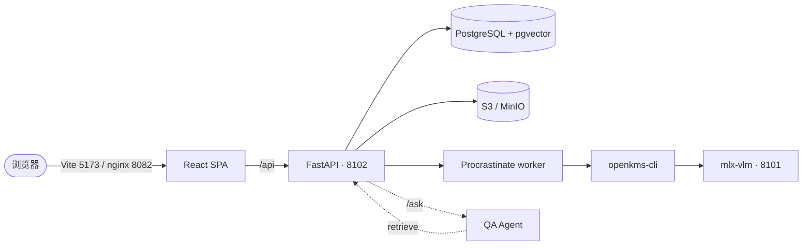

# openKMS

**开放知识管理系统（Open Knowledge Management System）** — openKMS 帮助企业快速构建站得住、改得动的智能决策系统。

决策系统：案件进来，套用规则与证据，给出一个结论。难的不是把应用做出来，而是让结论可依赖：有依据、可复算、说清边界。

[GitHub 仓库 :material-github:](https://github.com/yingrui/openKMS){ .md-button .md-button--primary }
[快速开始](quickstart.md){ .md-button }

---

## 你用它建什么

一个决策系统：案件进来 → 结论出去，并带上它的依据、计算和边界。

典型场景：报关归类、保险核保、质量放行、合规审查。

它不是应用生成器、文档库、聊天窗口或 BI 工具。完整论证见[目标与愿景](goals.md)。

## 它怎么工作

- 知识、数据、本体先行；AI 在其上构建系统。
- 规则明确；结论由有出处的数据算出来，不靠猜。
- 业务专家改规则；IT 负责数据接入、权限、安全与交付。

## 里面有什么

| 表面 | 作用 |
|------|------|
| **[文档（Documents）](features/documents.md)** | 上传 PDF 与 Office 文件；解析为可编辑 Markdown（PaddleOCR-VL，经独立 VLM 服务）；版本与策略**生命周期**。 |
| **[文章（Articles）](features/articles.md)** | Markdown CMS，含通道、附件与关系（`supersedes`、`amends`、`see_also` 等）。 |
| **[维基空间（Wiki spaces）](features/wiki-spaces.md)** | 基于路径的笔记、vault 导入、页面图谱、语义页面搜索。 |
| **[知识库（Knowledge bases）](features/knowledge-bases.md)** | 混合检索与**带来源的问答**（分块、来源、可选 QA Agent 服务）。 |
| **[本体](features/ontology.md)与[数据层](features/data-layer.md)** | 对象/链接类型、实例、数据集、语义模型；图查询与关系查询。 |
| **[函数与动作](features/ontology-functions.md)** | 已发布函数、对象上的类型化动作；执行与审计。 |
| **[Agent](features/openkms-agents.md)与 [skill](features/openkms-skill.md)** | Deep Agents 工作区，以及供 Agent 调用公共 API 的 openkms skill/CLI。 |
| **[议事厅（Chamber）](features/app-builder.md)** | 把决策系统 UI 登记到 Kubernetes Service 并运行；身份头与代理。 |

**底座：** [操作权限 + 资源 ACL](features/data-security.md)（管理员不意味着可读全部数据）、面向检索与 wiki 覆盖的[评测](features/evaluation.md)。

## 从哪里开始

| 如果你想… | 阅读 |
|-----------|------|
| 理解 openKMS **为何存在**（愿景与业务问题） | [目标与愿景](goals.md) |
| 用 Docker 或本机快速试用 | [快速开始](quickstart.md) |
| 通过搭迷你看板学习本体 | [教程：认识本体（看板实验）](tutorials/understanding-ontology.md) |
| 自己动手：Tushare → Stock → Function 案例 | [教程：Tushare 市场分析本体](tutorials/tushare-market-ontology.md) |
| 理解系统整体 | [架构](architecture.md) · [功能索引](functionalities.md) |
| 查找具体功能或 API | [功能索引](functionalities.md) → `features/*.md` |
| HTTP 或 schema 参考 | [API 参考](features/api-reference.md) · 数据模型 |
| 知识制品类型 | [知识类型](features/knowledge-types.md) |
| 共享与资源 ACL | [数据安全](features/data-security.md) |
| 用 Agent Skill / CLI 访问 openKMS | [openkms-skill](features/openkms-skill.md) |
| 搭建开发环境 | [开发者环境搭建](developer/setup.md) |
| 用 Docker 部署 | [运维 · Docker](operations/docker.md) |
| 审阅安全设计（原则） | [安全](security.md) · [数据安全](features/data-security.md) · [控制台与认证](features/console-and-auth.md) |
| 查看后续计划 | [路线图 · 开发计划](development_plan.md) |
| 与其他技术栈对比或阅读 KM 框架 | [研究](#research)（见下） |
| 编辑文档（人或 AI Agent） | [AI 代理文档规范](agents.md) |

## 研究 {#research}

面向架构与产品决策的笔记（非已交付功能规格）：

| 主题 | 文档 |
|------|------|
| RAG 引擎 vs openKMS | [RAGFlow 与 openKMS](research/ragflow_vs_openkms.md) |
| Confluence AI（Rovo）vs openKMS | [Confluence AI 与 openKMS](research/confluence_ai_vs_openkms.md) |
| LLM wiki（llm_wiki）vs 维基空间 | [LLM wiki 与 openKMS](research/llm_wiki_comparison.md) |
| 衡量 KM 成效（OKF 维度） | [运营知识健康度](research/km_dimension_operational_fitness.md) |
| 评测文章与维基文本 | [文本内容评测](research/text_content_evaluation.md) |

## 一览

| 服务 | 默认端口 |
|------|----------|
| 后端（FastAPI） | **8102** |
| 前端（Vite 开发） | **5173** |
| 前端（Docker，nginx） | **8082** |
| VLM 服务（mlx-vlm） | **8101** |

## 项目结构

| 路径 | 内容 |
|------|------|
| `backend/` | FastAPI 服务、async SQLAlchemy、Alembic 迁移 |
| `frontend/` | React 19 + Vite SPA |
| `openkms-cli/` | 文档解析 / 流水线 CLI（worker 调用） |
| `openkms-skill/` | 可选 SKILL + CLI（Agent 用 Bearer 个人 API Key；不在 Docker 内） |
| `vlm-server/` | mlx-vlm HTTP 服务（PaddleOCR-VL 后端） |
| `docker/` | Dockerfile 与 `docker-compose.yml` |
| `docs/` | 本站文档 |
