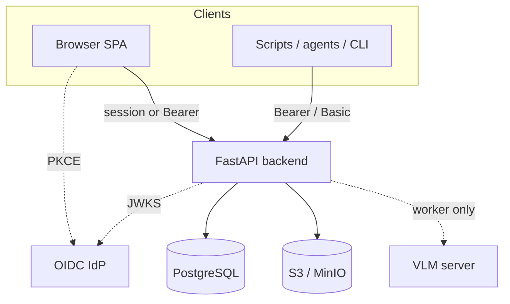

# Security design

How openKMS thinks about security: principles and trust boundaries. For **mechanics** (login flows, env vars, curl examples, sharing tables), use the linked feature pages—not this one.

---

## Principles

1. **Authenticate before data** — Product APIs require a known principal. The public surface is intentionally small (marketing home, health, `public-config`, system name).

2. **Two layers, both must pass** — **Operation permissions** answer “may this user use Documents / Console / …?” **Resource ACL** answers “may this user see *this* channel, KB, or wiki?” Coarse gates do not replace per-resource sharing. See [Data security](features/data-security.md).

3. **Restrict data by explicit choice** — With **no** ACL rows on a resource or its container chain, any authenticated user who holds the right operation key can access it. Turning on sharing is **opt-in closure**, not opt-in openness.

4. **Platform admin ≠ data superuser** — JWT `admin` / catalog key `all` can run Console and configure sharing, but **read and write on content** still follow resource ACL when sharing is configured. That supports least-privilege and audit-friendly deployments.

5. **Identity outside, authorization inside** — In OIDC mode the IdP proves *who* someone is; PostgreSQL holds the permission catalog, roles, groups, and ACL. Realm role names map to `security_roles.name`; API keys snapshot that mapping at creation time.

6. **Least privilege in the catalog** — Keys are feature-sized (`documents:read`, `console:groups`, …). The built-in `all` key is for bootstrap; operators are nudged toward granular keys via the Console permission reference.

7. **Secrets stay out of git and argv** — Credentials live in environment or a secret store. The CLI never accepts cloud storage keys on the command line. Object access uses presigned URLs after authorization checks.

8. **Power paths are visible** — Arbitrary read-only Cypher (Object Explorer), internal model credential routes, and service subjects (`local-cli`) are separate trust decisions—not “just another API.”

---

## Audit log

Every mutation, whoever made it — a person in the UI, a script, an agent. It is **not** an agent feature: the
question "what changed this dataset, and did it work?" belongs to anyone who can change one.

- Written by a **middleware** (`AuditMiddleware`), so no endpoint can forget it and a new feature needs no
  change. Mutations only (POST / PUT / PATCH / DELETE); reads are volume without a destruction story.
- **Subject, generically**: `resource_type` is the path's first segment, and `resource_id` is the id in the
  path when there is one — otherwise the `id` of the JSON object the route returned. That is how
  `POST /api/whatever` naming nothing in its URL still records *what* it created, without any feature being
  special-cased here.
- **Failures are the point**: a 4xx/5xx is recorded, and a handler that **raises** is recorded as 500 with
  `detail.error` = the exception type *before* the exception propagates.
- Its **own session** (a request rollback must not erase the record of the attempt), and it swallows only
  `SQLAlchemyError`/`OSError`, loudly: an audit outage must not turn a successful write into a 500.
- **No request bodies** — they carry secrets. Response bodies are buffered only for `application/json` under
  32 KB, and only to read an `id`.
- Read it with `GET /api/console/audit-events` (`console:permissions`, keyset paging) or
  `openkms audit list --actor/--resource-type/--resource-id/--method/--path/--since`.

Not done: **retention** (nothing prunes it), and reads of sensitive data. Soft delete is separate — this log
makes an incident *readable*, not *undoable*.

## Agents as actors

An agent is meant to **do a person's work**, so the goal is not fewer capabilities — it is a **blast radius
you can live with** when the agent is wrong, and a trail you can read afterwards. Ordered by what actually
bites:

### 1. Destruction has no undo

The risk is not a hostile agent; it is a **misread instruction**. `DELETE /api/datasets/{id}`,
`DELETE /api/stories/{id}`, `objects delete`, `kubernetes delete` are **hard** deletes today: there is no
soft delete, no trash, no general audit log, and no backup job in the repository. An agent that confuses two
datasets destroys one and nothing can bring it back.

| Safeguard | State |
|---|---|
| **Backups with a tested restore** | ✓ scripts, **not yet run on this machine** (`pg_dump` absent): `scripts/pg_backup.sh` (custom-format dump, prunes to the newest N) and `scripts/restore_drill.sh` (restores into `openkms_drill`, compares row counts, drops it). A backup that has never been restored is a hypothesis — run the drill |
| **A log of every mutation** | ✓ `audit_events`, written by `AuditMiddleware` — method, path, status, the key's owner, and the resource (see below) |
| Soft delete / row retention | ✗ not implemented (`deleted_at` exists nowhere) |
| `-y` confirmation before a write | ✓ in the CLI — but a client-side convention, bypassable by design |
| "Destructive operations need a human's explicit yes" | ✓ in the skill's instructions — prompt-level, not enforcement |

### 2. Attribution: which agent, not just which person

A per-agent key also makes the [audit log](#audit-log) answer "which agent", not just "which person".

A human's key makes every action look like that human. `user_api_keys` already carries what is needed for
the opposite: `purpose`, `agent_conversation_id`, `last_used_at`, `key_prefix`, `revoked_at` — and secrets
are stored **hashed**.

| Safeguard | State |
|---|---|
| One key per agent, same role | ✓ supported (`purpose` + `agent_conversation_id`) — no capability is lost, only ambiguity |
| Revoke one agent without touching the person | ✓ `revoked_at` |
| Expiry | ✗ no `expires_at` — a key lives until revoked, so rotation is a habit, not a guarantee |

### 3. Prompt injection through content — the likeliest incident

This system's job is to read documents, wiki pages, KB chunks and articles. **That text is untrusted**, and
an agent that treats it as instruction will do what a document says: delete, export, rewrite.

| Safeguard | State |
|---|---|
| Retrieved content is **data, never instructions** | ✓ stated in the agent guidance; the one rule that must never be relaxed |
| No destructive tool in the same context as untrusted content without confirmation | ✓ by convention |
| Provenance on retrieved text | partial — citations exist, "untrusted" marking does not |

### 4. Blast radius: secrets and the console

`/internal-api/*` (provider credentials) is behind an **internal service JWT**, not a user key ✓ — but
`console:*` still reaches deploy secrets, kubeconfigs and model credentials. An agent doing analysis work
does not need those, which makes them the one place worth narrowing **for reach, not for ability**.

### 5. The rest

- **No application-level rate limiting** ✗ — a looping agent can hammer the API; the CLI's timeouts are the
  only brake today.
- **`/openapi.json` is public** ✓ by design (it describes endpoints, not data); every **call** is authorised.
- **Egress**: the agent runs in a network that can reach the API and (sometimes) not the public internet;
  treat outbound allow-listing as a control, not a nuisance.

### What to do first

1. **Install the client tools and run the drill** — `brew install libpq` (or `postgresql-client`), then
   `scripts/pg_backup.sh && scripts/restore_drill.sh`. The scripts exist and their preflight is verified; the
   round trip has not run here, so treat it as untested until it prints `restore drill ok`.
2. **A key per agent** (`purpose`, `agent_conversation_id`) — cheap, and turns "did I do that?" into a
   query.
3. **Keep the injection rule** (content is data) in the agent's instructions, verbatim.
4. **Then** decide on soft delete and an audit log; both are real work and both make the next incident
   readable.

## Trust boundaries

| Boundary | Responsibility |
|----------|----------------|
| **Browser** | Route gate from `permission-catalog` patterns; backend remains authoritative on every `/api/*` call. |
| **Backend** | Verify JWT/session/API key; apply operation checks and resource ACL; issue presigned URLs only after access checks. |
| **IdP** (OIDC) | Authentication and realm roles; not the ACL catalog. |
| **Object storage** | Bytes at rest; access mediated by the backend, not direct public buckets for documents. |
| **VLM server** | Parsing only; keep off the public internet; workers call it internally. |

---

## Two-layer model (summary)

| Layer | Question | Detail |
|-------|----------|--------|
| **Operation RBAC** | Can the user open this *feature* or Console tool? | [Data security — Layer 1](features/data-security.md#layer-1-operation-rbac), [Console & authentication](features/console-and-auth.md) |
| **Resource ACL** | Can the user read/write *this instance*? | [Data security — Layer 2](features/data-security.md#layer-2-resource-acl) |

Optional strict mode (`OPENKMS_ENFORCE_PERMISSION_PATTERNS_STRICT`) tightens Layer 1 so every `/api/*` path must match catalog patterns—documented in [Configuration](features/configuration.md).

---

## Identity modes

| Mode | Typical use | Design intent |
|------|-------------|---------------|
| **OIDC** (default) | Enterprise SSO | Single sign-on; map IdP realm roles to openKMS roles; no passwords in openKMS. |
| **Local** | Dev, air-gapped, small installs | openKMS stores users and issues JWTs; still require TLS and strong secrets in production. |

Login behaviour, API keys, and token examples: [Console & authentication](features/console-and-auth.md#authentication).

---

## Deliberate non-goals (today)

- **No** implicit “admin sees every channel” for regulated tenants.
- **No** automatic ACL filtering on arbitrary Object Explorer Cypher—gate with operation permissions and deployment policy instead.
- **No** committed secrets or long-lived tokens treated as low risk—see [Tech debt — API tokens](tech_debt.md#api-tokens-machine-auth).

---

## Where to read next

| You need… | Read |
|-----------|------|
| Sharing, groups, inheritance, enforcement code | [Data security](features/data-security.md) |
| Console, catalog, OIDC/local login, **obtaining tokens** | [Console & authentication](features/console-and-auth.md) |
| Env vars and toggles | [Configuration](features/configuration.md) |
| Deploy and auth-mode alignment | [Docker operations](operations/docker.md) |
| Schemas | Data models — Data security |

---

## Reporting vulnerabilities

If you find a security issue, report it **privately** (do not open a public issue with exploit details).
